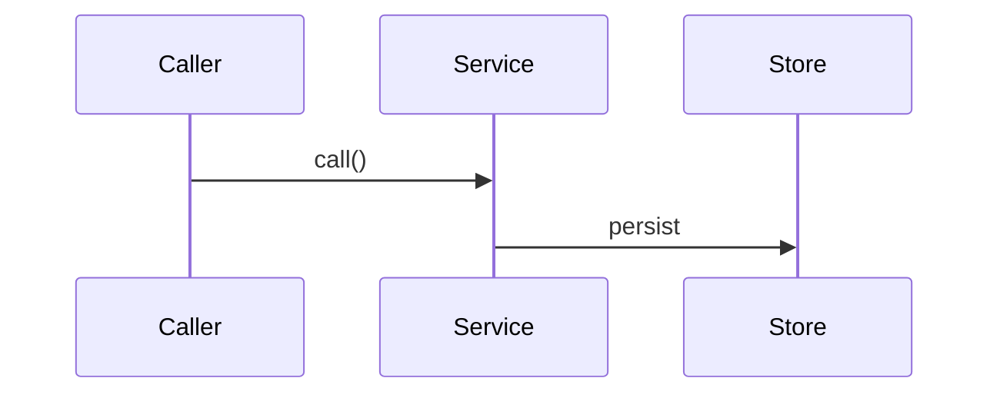

# [Epic name]

## 1. Architecture

### 1.1 Overview

Two or three sentences: the problem and why this epic exists. Link the decision.

### 1.2 Goals

- Measurable outcome
- Measurable outcome
- Acceptance: the one check the builder runs itself and loops on, programmatic (a type check, a grep, a `diff` against a baseline, a test) or a reference plus judges (captures next to a named reference, three judges on named points)

### 1.3 Current structure _(optional, skip for greenfield)_

```
path/today/
├── file-a.ts
└── file-b.ts
```

### 1.4 Target structure

```
path/after/
├── file-a.ts        ← one-line purpose
└── sub/
    └── file-c.ts    ← one-line purpose
```

### 1.5 Flow _(optional, for dispatch, state machines, cross-service flows)_



Sketch: [reference/flow.excalidraw](reference/flow.excalidraw) _(when one exists)_

### 1.6 Components

One block per logical unit the epic introduces or modifies. Required: a short description
and a bullet list of what it does and does not do. Optional: operations table, interfaces,
dependencies, stays unchanged, usage examples.

#### 1.6.1 Data artifacts _(optional, always first when present)_

Registry items, config files, generated files, changelog entries: what changes in them.

#### 1.6.2 [Component]

Description and the scope decisions that shaped it.

- Does X
- Does NOT do Y

**Operations:**

| Operation | Status | Notes |
| --------- | ------ | ----- |
| `doX()`   | new    |       |

**Interfaces:**

```typescript
export interface Example {
  readonly id: string;
}
```

**Stays unchanged:** files this component touches without modifying.

**Usage:**

```typescript
example.doX({ id });
```

### 1.7 Dependencies and env _(optional)_

New packages, env vars (name, default, purpose), reused infrastructure.

## 2. Instructions for AI

### 2.1 Milestones

### Milestone: [Name]

- Files owned: [a, b]
- Depends on: [milestone names or epic numbers, or none]
- Review: [none | fable]
- Local CI: [none | `pnpm test --changed` | `act pull_request -j <job>`] (what runs on the merged tree before the merge, beyond the task checks)
- Task 1: [what]. Checks: [commands]
- Task 2: [what]. Checks: [commands]
- Task N: Cleanup, delete old code, update references. Checks: repo checks

### 2.2 Checks

- `command` per base, what green means
