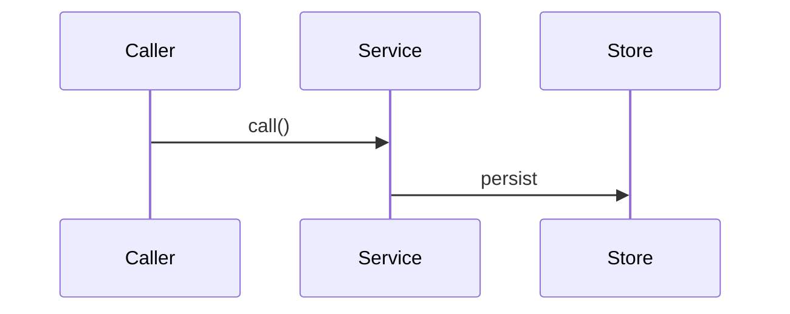

# [Spec name]

## 1. Architecture

### 1.1 Overview

Two or three sentences: the problem and why this spec exists. Cite the decision, as (D<n>).

### 1.2 Goals

- Measurable outcome
- Measurable outcome
- Acceptance: the one check the builder runs itself and loops on, programmatic (a type check, a grep, a `diff` against a baseline, a test) or a reference plus judges (captures next to a named reference, three judges on named points)

### 1.3 Current structure _(optional, skip for greenfield)_

```
path/today/
├── file-a.ts
└── file-b.ts
```

### 1.4 Target structure

```
path/after/
├── file-a.ts        ← one-line purpose
└── sub/
    └── file-c.ts    ← one-line purpose
```

### 1.5 Flow _(optional, for dispatch, state machines, cross-service flows)_



Sketch: [reference/flow.excalidraw](reference/flow.excalidraw) _(when one exists)_

### 1.6 Modules

A module in a spec is one unit of the design. One block per module the spec introduces or
modifies, grouped by logical unit, not by file. Required: a short description and a bullet
list of what it does and does not do. Optional: operations table, interfaces, dependencies,
stays unchanged, usage examples.

#### 1.6.1 Data artifacts _(optional, always first when present)_

Data models and fields, stored enums, config files, generated files: what changes in them.
One entry per data model, with every field.

#### 1.6.2 [Module]

Description and the scope decisions that shaped it.

- Does X
- Does NOT do Y

**Operations:**

| Operation | Status | Notes |
| --------- | ------ | ----- |
| `doX()`   | new    |       |

**Interfaces:**

```typescript
export interface Example {
  readonly id: string;
}
```

**Stays unchanged:** files this module touches without modifying.

**Usage:** one example per distinct caller pattern.

```typescript
example.doX({ id });
```

### 1.7 Dependencies and env _(optional)_

New packages, env vars (name, default, purpose), reused infrastructure.

## 2. Instructions for AI

### 2.1 Tasks

One entry per task, each defined once. The section number is the task's id. A task points to
its detail: `Detail:` a section of this file, or `Plan:` a task file in `tasks/`.

#### 2.1.1 Task: [what] (D<n>)
- [One line of what it is.]
- Checks: [commands]
- Detail: 1.6.2

#### 2.1.2 Task: Cleanup, delete old code, update references
- Checks: the project's checks

### 2.2 Milestones

One block per milestone. A milestone is one branch, one worktree, one tracker and one merge.
`Tasks` is required. Write the other lines when they help: `Files owned` when the milestone
could clash with other running work, `Depends on` when the order matters (with no line, the
milestones of a spec run in the order listed).

#### 2.2.1 Milestone: [Name]
- Tasks: 2.1.1, 2.1.2
- Files owned: [a, b]
- Depends on: [milestone names or spec numbers, or none]
- Review: [none | fable]
- Local CI: [none | `pnpm test --changed` | `act pull_request -j <job>`] (what runs on the merged tree before the merge, beyond the task checks)

### 2.3 Checks

- `command` per base, what green means
